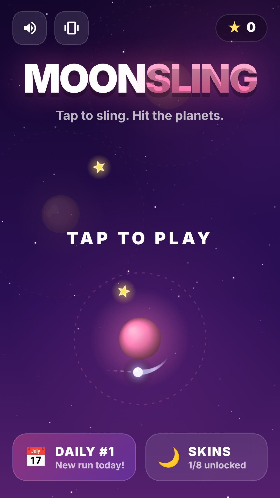
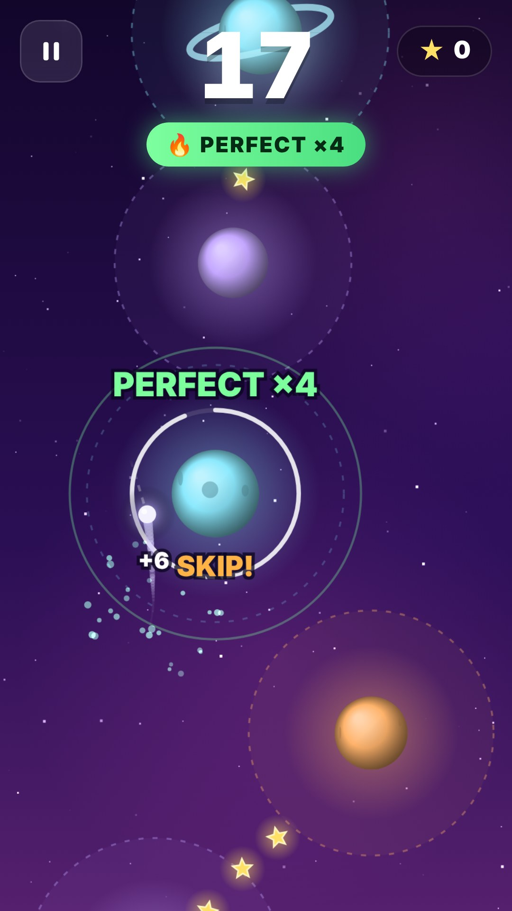
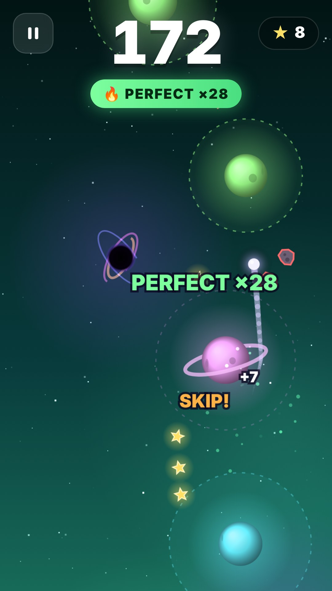
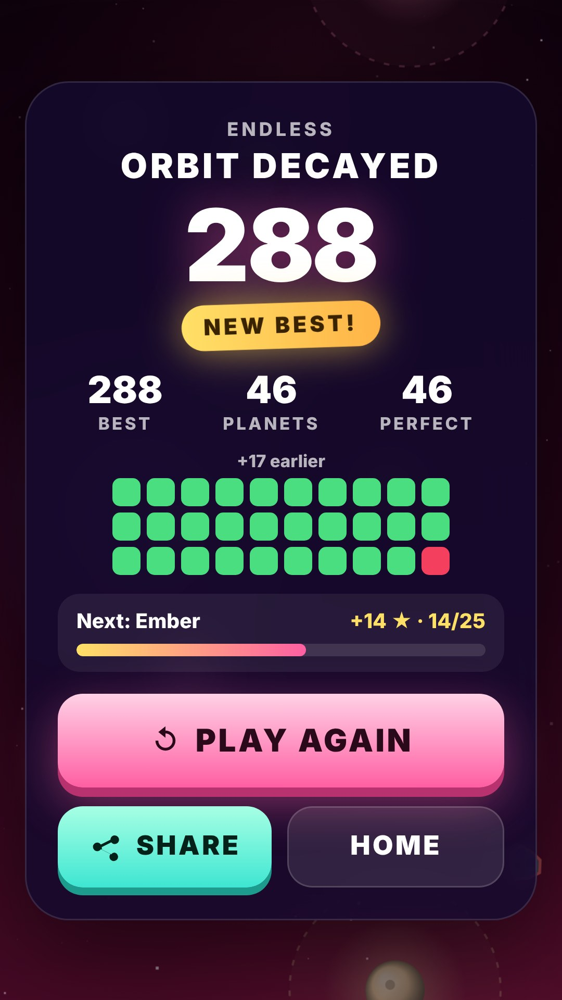

# Moonsling 🌙

**Tap to sling. Hit the planets.**

Moonsling is a one-tap arcade game for Android phones, iPads and iPhones, and it also runs in any browser. Your moon orbits a planet. Tap to fling it off along its orbit and get caught by the next planet's gravity. Aim dead-centre for a **PERFECT** and build a streak. Don't wait too long, though: every orbit decays.

<p align="center">
  
  
  
  
</p>

## Why it's built to spread

| Hook | How Moonsling does it |
| --- | --- |
| **Learn in 1 second** | One input (tap) with a visible aim line. The first game shows a full trajectory guide. |
| **"One more try"** | Runs last 20–90 s. *Play again* is one tap and you're back in under a second. |
| **Juice** | Slow-mo on perfects, a rising musical pitch with your streak, particles, screen shake and haptics. |
| **Daily Challenge** | Everyone gets the same seeded level each day, so friends compare scores on equal terms. |
| **Spoiler-free sharing** | Wordle-style emoji grid (🟩 perfect, 🟨 good, 💥 crash) plus an auto-generated 1080×1350 score card image. |
| **Streaks** | Playing the daily on consecutive days builds a 🔥 streak with a growing ★ bonus. |
| **Progression** | Collect ★ during runs to unlock 8 moon skins. Six colour zones (Nebula → Lagoon → Aurora → Ember → Crimson → Void) mark how far you got. |
| **Rising challenge** | Moving planets (8+), asteroids (12+), pulsing capture zones (22+), black holes that bend your path (28+). |
| **Frictionless** | ≈140 KB release APK. Works offline. No accounts, no ads, no tracking. The only permission is vibration. |

Example share text:

```
🌙 Moonsling Daily #1 — 57 pts 🔥3
🪐 31 planets · ✨ 12 perfect
🟩🟩🟨🟩🟩🟩🟨🟨🟩🟩
🟩🟩🟨🟩🟨🟩🟩🟩🟨🟨
🟩🟩🟩🟨🟩🟩🟨🟩🟨💥
Can you beat today's run?
https://play.google.com/store/apps/details?id=com.viralphonegame.moonsling
```

## Play it now

- **On iPad or iPhone:** see [Play on iPad / iPhone](#play-on-ipad--iphone) below.
- **In a browser:** serve the `web/` folder, e.g. `npx serve web` or `python3 -m http.server -d web`, and open it on your phone or desktop. On desktop, Space or Enter taps.
- **On Android:** every push builds a debug APK in GitHub Actions (**Actions → Build → artifact `moonsling-debug-apk`**). To build it locally, see below. To install it, copy it to your phone and open it (you'll need to allow "install unknown apps"), or run `adb install -r app-debug.apk`.

## Play on iPad / iPhone

Apple devices can't install Android apps, so on iPad and iPhone Moonsling runs as a web app that you add to the Home Screen. It gets its own icon, opens full screen, works offline after the first launch, and saves progress on the device. The layout fills an iPad held upright, the menus scale up for the bigger screen, and it also works in landscape.

**One-time setup: put the game online with GitHub Pages**

1. GitHub Pages is free for public repositories. For a private repository it needs a paid GitHub plan. On a free plan, make the repository public first: **Settings → General → Danger Zone → Change visibility**.
2. Go to **Settings → Pages → Build and deployment** and set **Source** to **GitHub Actions**.
3. The **Deploy web version** workflow publishes `web/` on every push to the default branch. To publish straight away, run it from the **Actions** tab. The site address is `https://<your-username>.github.io/Viralphonegame/`.

**On the iPad**

1. Open the site address in **Safari**.
2. Tap the **Share** button (the square with an arrow), then **Add to Home Screen**, then **Add**.
3. Start Moonsling from its icon on the Home Screen.

A version in the App Store is also possible, but it needs a Mac with Xcode and an Apple Developer account ($99 a year).

## Build the Android app

Requirements: JDK 17+ and the Android SDK (platform 36). Android Studio has both; open this folder in it.

```bash
./gradlew assembleDebug          # → app/build/outputs/apk/debug/app-debug.apk
./gradlew installDebug           # install on a connected device
```

The game itself is the HTML5 code in [`web/`](web/). Gradle packages that folder as app assets, and [`MainActivity.kt`](app/src/main/java/com/viralphonegame/moonsling/MainActivity.kt) runs it in a full-screen WebView. The activity also provides:

- Haptics through the Android vibrator.
- The native share sheet, including the score card image (through a `FileProvider`).
- Immersive mode and handling of the display notch.
- Back-button and pause/resume handling.

Because there's one codebase, a change to the game shows up in both the APK and the web version.

## Publish on Google Play

1. **Pick your app id.** Change `applicationId` in [`app/build.gradle.kts`](app/build.gradle.kts), e.g. `com.yourname.moonsling`. It's permanent once published.
2. **Create an upload key.** Keep it safe; it's git-ignored.
   ```bash
   keytool -genkeypair -v -keystore upload.jks -alias upload -keyalg RSA -keysize 2048 -validity 10000
   ```
   Then create `keystore.properties` in the repo root:
   ```properties
   storeFile=upload.jks
   storePassword=…
   keyAlias=upload
   keyPassword=…
   ```
3. **Build the bundle:** `./gradlew bundleRelease` produces `app/build/outputs/bundle/release/app-release.aab`.
4. **Play Console:** create the app and upload the `.aab` to a testing track. At the time of writing, *new personal* developer accounts must run a closed test with at least 12 testers for 14 days before going to production.
5. **Store listing assets** are ready in [`store/`](store/):
   - `icon-512.png`: hi-res icon
   - `feature-graphic.png`: 1024×500
   - `screenshots/*.jpg`: 1080×1920 phone screenshots
   - `screenshots/07-share-card.png`: a sample of the share image
6. **Data safety:** the game collects and shares no data and has no internet permission. **Content rating:** no violence or user-generated content.

Every update needs `versionCode` and `versionName` bumped in `app/build.gradle.kts`.

## Ideas to grow it

- **Host the web build.** Put `web/` on GitHub Pages, itch.io or Netlify. When the page is served over http(s), share links point to it, so friends can play straight from the link. You can also hard-code a link with `window.MOONSLING_SHARE_URL = '…'` in `index.html`.
- **Short-form video.** Long PERFECT streaks with the slow-mo and rising pitch are made for TikTok, Reels and Shorts clips.
- **Leaderboards.** Google Play Games Services leaderboards for the daily and best scores.
- **Monetization (optional).** A rewarded "continue" ad, a remove-ads purchase, or skin packs. Adding ads means adding the `INTERNET` permission and updating the Data safety form.

## Project layout

```
web/                    the game (HTML5 canvas, no dependencies)
  js/core.js            simulation: physics, level generation, scoring, daily seeds, share text
  js/render.js          canvas renderer + effects
  js/audio.js           synthesized sound effects (WebAudio, no audio files)
  js/share.js           score-card image + share sheet / clipboard fallback
  js/main.js            game loop, input, screens, saves, haptics, Android bridge hooks
  sw.js                 offline cache for the installed web app (iPad / iPhone / browser)
app/                    Android wrapper (Kotlin, WebView)
tools/
  core.test.mjs         unit tests (node --test tools/core.test.mjs)
  sim.mjs               balance simulator with look-ahead & "human" bots
  screenshots.mjs       headless smoke test + screenshots of every screen
  store-art.mjs         renders the Play Store icon & feature graphic
store/                  Play Store listing assets
```

## Tuning

The game's balance lives in `web/js/core.js`:

- `difficulty()`: how fast the game ramps up.
- `_makePlanet()`: capture-zone size, orbit speed and decay time.
- `_genNext()` and `_genGap()`: spacing, moving planets, stars and hazards.
- `SKINS`: skin prices.

After changing these, run `node tools/sim.mjs`. It checks that a look-ahead bot can still clear every level, and it estimates how far players with different reaction times get. Current numbers: the bot reaches 120+ planets on every seed, and simulated humans reach a median of 11–20 planets depending on reaction time.
